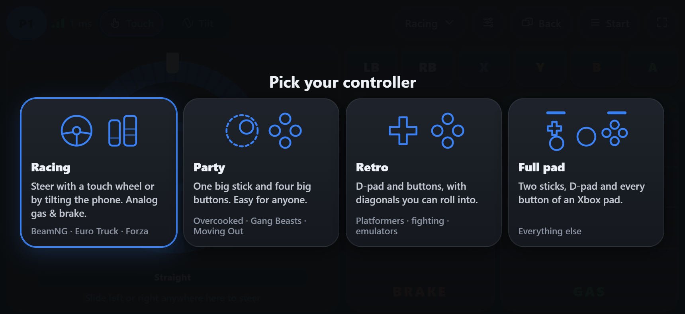
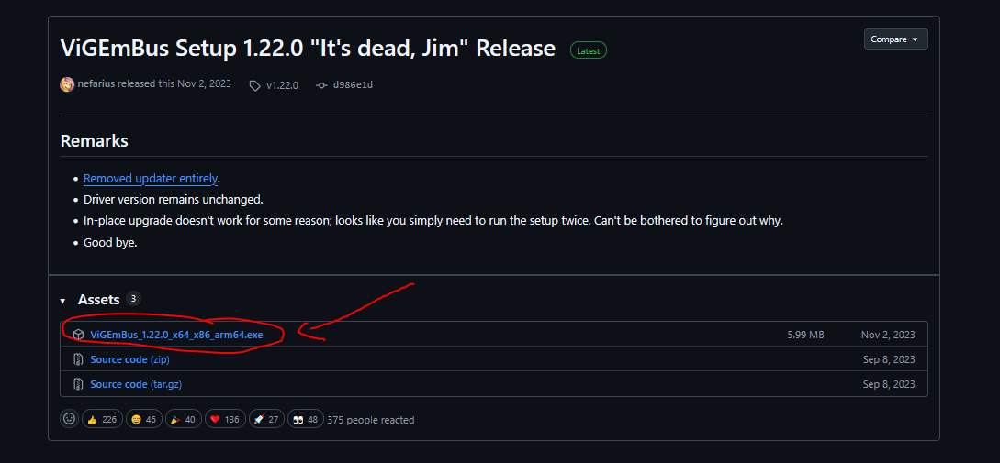

<div align="center">


# Player Four

**Your phone is the controller.**

Scan a QR code and up to four phones become Xbox controllers on your PC.<br>
No app to install, no account, no cloud.


[](LICENSE)
[](https://github.com/Orest-Z/player-four/actions/workflows/ci.yml)


</div>

## Why

Not everyone owns four controllers, but almost everyone has a phone. Player Four turns
the phones already in the room into controllers for couch co-op, party games and racing
games, for free.

## Features

- **Four players, one QR code.** Every phone scans the same code and becomes its own
  Xbox 360 controller. Games see real controllers, so there's nothing to set up in the game.
- **Racing that feels right.** Steer by tilting the phone, or grab the on-screen wheel and turn
  it like a real one, up to 1080° to match sims like Euro Truck Simulator 2 (900°). Press gas
  and brake as gently or as hard as you like.
- **Feel the game.** When a game rumbles the controller, the phone shakes too, harder for
  stronger rumble (Android: iPhones don't let web pages vibrate).
- **A layout for every game.** Racing, Party (one stick, four big buttons), Retro (D-pad)
  and a Full pad with every button.
- **Built for low latency.** Phone and PC talk directly over your Wi-Fi. There's no server
  in between, and a late input is dropped rather than waited for.
- **Light on your PC.** A small native app. Hidden in the tray, it uses no CPU, even mid-game.

<p align="center">
  
  
</p>

## Play

1. Download `PlayerFour-…-windows.zip` from [Releases](https://github.com/Orest-Z/player-four/releases),
   unzip it anywhere and open **Player Four.exe**. It's one file: nothing to install.
   - If Windows says "Windows protected your PC", click **More info → Run anyway**.
   - If Windows asks about network access, allow it on private networks.
2. Install the controller driver once ([how](#installing-the-controller-driver)).
   Player Four tells you if it's missing.
3. Scan the QR code with each phone's camera. Phones need to be on the same Wi-Fi as the PC.
4. The first time, each phone's browser warns about the connection. Tap **Advanced →
   Proceed** on Android, or **Show Details → visit this website** on iPhone. The warning
   is about the PC's own certificate, which phones need before they'll share their tilt sensor.
5. Pick a layout and play. In the phone's settings, each player can set a name and color.

Closing the window keeps Player Four in the tray, so everyone stays connected.

**Updates:** when a new version is out, a **New version** button appears at the top of the
window. Download the new zip and replace the old `Player Four.exe`. Your settings stay. To
find out, Player Four asks GitHub for the latest version when it starts and once a day.
That's the only thing it sends to the internet, and it says nothing about you or your games.

### Installing the controller driver

Player Four uses the free ViGEmBus driver to create the controllers, and you only install it
once. If it's missing, Player Four shows an **Open the download page** button that goes
straight there.

1. On the [ViGEmBus release page](https://github.com/nefarius/ViGEmBus/releases/latest),
   under **Assets**, click the installer:

   

2. Open the file you downloaded and click through the installer:

   

3. That's it. Player Four notices the driver on its own.

If Windows SmartScreen warns about the installer, it's safe to continue (**More info → Run
anyway**) as long as you downloaded it from the GitHub page above. Already using
DS4Windows? Then you have the driver.

## What to play

Anything that works with an Xbox controller works with Player Four. Here are ten favorites for
each layout. "Couch" means several phones can play together on one PC.

### Racing

Steer by tilting the phone or with the touch wheel, with analog gas and brake.

<table>
<tr>
<td align="center" width="20%"><a href="https://store.steampowered.com/app/284160/"></a><br><sub><b>BeamNG.drive</b><br>Couch co-op</sub></td>
<td align="center" width="20%"><a href="https://store.steampowered.com/app/227300/"></a><br><sub><b>Euro Truck Simulator 2</b><br>Solo</sub></td>
<td align="center" width="20%"><a href="https://store.steampowered.com/app/1551360/"></a><br><sub><b>Forza Horizon 5</b><br>Solo</sub></td>
<td align="center" width="20%"><a href="https://store.steampowered.com/app/2225070/"></a><br><sub><b>Trackmania</b><br>Couch versus</sub></td>
<td align="center" width="20%"><a href="https://store.steampowered.com/app/252950/"></a><br><sub><b>Rocket League</b><br>Couch co-op & versus</sub></td>
</tr>
<tr>
<td align="center" width="20%"><a href="https://store.steampowered.com/app/1271700/"></a><br><sub><b>Hot Wheels Unleashed</b><br>Couch versus</sub></td>
<td align="center" width="20%"><a href="https://store.steampowered.com/app/785260/"></a><br><sub><b>Team Sonic Racing</b><br>Couch versus</sub></td>
<td align="center" width="20%"><a href="https://store.steampowered.com/app/1038250/"></a><br><sub><b>DIRT 5</b><br>Couch co-op & versus</sub></td>
<td align="center" width="20%"><a href="https://store.steampowered.com/app/389140/"></a><br><sub><b>Horizon Chase Turbo</b><br>Couch versus</sub></td>
<td align="center" width="20%"><a href="https://store.steampowered.com/app/1238080/"></a><br><sub><b>Burnout Paradise Remastered</b><br>Take turns</sub></td>
</tr>
</table>

### Party

One big stick and big buttons: easy for anyone, even people who never play.

<table>
<tr>
<td align="center" width="20%"><a href="https://store.steampowered.com/app/728880/"></a><br><sub><b>Overcooked! 2</b><br>Couch co-op & versus</sub></td>
<td align="center" width="20%"><a href="https://store.steampowered.com/app/996770/"></a><br><sub><b>Moving Out</b><br>Couch co-op</sub></td>
<td align="center" width="20%"><a href="https://store.steampowered.com/app/285900/"></a><br><sub><b>Gang Beasts</b><br>Couch versus</sub></td>
<td align="center" width="20%"><a href="https://store.steampowered.com/app/477160/"></a><br><sub><b>Human Fall Flat</b><br>Couch co-op</sub></td>
<td align="center" width="20%"><a href="https://store.steampowered.com/app/1509960/"></a><br><sub><b>PICO PARK</b><br>Couch co-op</sub></td>
</tr>
<tr>
<td align="center" width="20%"><a href="https://store.steampowered.com/app/386940/"></a><br><sub><b>Ultimate Chicken Horse</b><br>Couch co-op & versus</sub></td>
<td align="center" width="20%"><a href="https://store.steampowered.com/app/674940/"></a><br><sub><b>Stick Fight: The Game</b><br>Couch versus</sub></td>
<td align="center" width="20%"><a href="https://store.steampowered.com/app/312530/"></a><br><sub><b>Duck Game</b><br>Couch versus</sub></td>
<td align="center" width="20%"><a href="https://store.steampowered.com/app/965680/"></a><br><sub><b>Boomerang Fu</b><br>Couch co-op & versus</sub></td>
<td align="center" width="20%"><a href="https://store.steampowered.com/app/880940/"></a><br><sub><b>Pummel Party</b><br>Couch versus</sub></td>
</tr>
</table>

### Retro

A D-pad you can roll into diagonals, plus buttons: platformers, brawlers and fighting games.

<table>
<tr>
<td align="center" width="20%"><a href="https://store.steampowered.com/app/1118310/"></a><br><sub><b>RetroArch (classic consoles)</b><br>Couch co-op & versus</sub></td>
<td align="center" width="20%"><a href="https://store.steampowered.com/app/1361510/"></a><br><sub><b>TMNT: Shredder's Revenge</b><br>Couch co-op</sub></td>
<td align="center" width="20%"><a href="https://store.steampowered.com/app/985890/"></a><br><sub><b>Streets of Rage 4</b><br>Couch co-op & versus</sub></td>
<td align="center" width="20%"><a href="https://store.steampowered.com/app/204360/"></a><br><sub><b>Castle Crashers</b><br>Couch co-op & versus</sub></td>
<td align="center" width="20%"><a href="https://store.steampowered.com/app/251470/"></a><br><sub><b>TowerFall Ascension</b><br>Couch co-op & versus</sub></td>
</tr>
<tr>
<td align="center" width="20%"><a href="https://store.steampowered.com/app/291550/"></a><br><sub><b>Brawlhalla</b><br>Couch co-op & versus</sub></td>
<td align="center" width="20%"><a href="https://store.steampowered.com/app/242550/"></a><br><sub><b>Rayman Legends</b><br>Couch co-op</sub></td>
<td align="center" width="20%"><a href="https://store.steampowered.com/app/268910/"></a><br><sub><b>Cuphead</b><br>Couch co-op</sub></td>
<td align="center" width="20%"><a href="https://store.steampowered.com/app/584400/"></a><br><sub><b>Sonic Mania</b><br>Couch co-op & versus</sub></td>
<td align="center" width="20%"><a href="https://store.steampowered.com/app/586200/"></a><br><sub><b>Street Fighter 30th Anniversary Collection</b><br>Couch versus</sub></td>
</tr>
</table>

### Full pad

Two sticks, D-pad and every button, for games that need it all.

<table>
<tr>
<td align="center" width="20%"><a href="https://store.steampowered.com/app/1426210/"></a><br><sub><b>It Takes Two</b><br>Couch co-op</sub></td>
<td align="center" width="20%"><a href="https://store.steampowered.com/app/2001120/"></a><br><sub><b>Split Fiction</b><br>Couch co-op</sub></td>
<td align="center" width="20%"><a href="https://store.steampowered.com/app/1222700/"></a><br><sub><b>A Way Out</b><br>Couch co-op</sub></td>
<td align="center" width="20%"><a href="https://store.steampowered.com/app/620/"></a><br><sub><b>Portal 2</b><br>Couch co-op</sub></td>
<td align="center" width="20%"><a href="https://store.steampowered.com/app/413150/"></a><br><sub><b>Stardew Valley</b><br>Couch co-op</sub></td>
</tr>
<tr>
<td align="center" width="20%"><a href="https://store.steampowered.com/app/1672970/"></a><br><sub><b>Minecraft Dungeons</b><br>Couch co-op</sub></td>
<td align="center" width="20%"><a href="https://store.steampowered.com/app/1313140/"></a><br><sub><b>Cult of the Lamb</b><br>Couch co-op</sub></td>
<td align="center" width="20%"><a href="https://store.steampowered.com/app/1599660/"></a><br><sub><b>Sackboy: A Big Adventure</b><br>Couch co-op</sub></td>
<td align="center" width="20%"><a href="https://store.steampowered.com/app/920210/"></a><br><sub><b>LEGO Star Wars: The Skywalker Saga</b><br>Couch co-op</sub></td>
<td align="center" width="20%"><a href="https://store.steampowered.com/app/1665460/"></a><br><sub><b>eFootball</b><br>Couch co-op & versus</sub></td>
</tr>
</table>

<sub>Game images and links: Steam. RetroArch plays classic console games you own.</sub>

## How it works

```
phone browser ── WebRTC, over your Wi-Fi ──▶ player-four.exe ── ViGEmBus ──▶ Xbox 360 controller ──▶ game
```

- The QR code holds everything a phone needs to reach the PC: its address, a one-time
  password and its certificate's fingerprint. The phone builds the connection itself, so
  there's no signaling server.
- Each input is a 14-byte packet in XInput's own layout, sent on an unordered channel with
  no retransmits.
- The PC app is Rust ([str0m](https://github.com/algesten/str0m) for WebRTC,
  [egui](https://github.com/emilk/egui) for the window). The phone app is plain JavaScript,
  checked by strict TypeScript, with no build step.

## Build from source

You'll need Windows 10/11, [Rust](https://rustup.rs) and ViGEmBus.

```
cd pc
cargo build --release
```

That gives `pc\target\release\player-four.exe`, with the phone app packed inside.
To make the download (the program, its README and a zip):
`powershell -ExecutionPolicy Bypass -File pack\pack.ps1`, which writes to `dist\`.

**Tests:** `node tests/run.mjs` type-checks the phone app, then plays phones in headless
Chrome against the real PC app and reads the controllers back the way a game would.
It needs Node 22+, Chrome and ViGEmBus. On every push and pull request, CI runs the Rust
tests and the type check. The phone tests need ViGEmBus, so they run on your PC only.

**Releasing:** run the tests, raise `version` in `pc/Cargo.toml` and commit, then push a tag
of `v` plus that version: `git tag v0.3.0`, then `git push origin main v0.3.0`. CI checks that
the tag matches the version, builds the zip and attaches it to a draft release. Write the
notes and publish it: older copies then show their **New version** button.

| Folder     | What's inside                                              |
| ---------- | ---------------------------------------------------------- |
| `phone/`   | The controller web app that phones open                    |
| `pc/`      | The PC app: connections, virtual controllers, window, tray |
| `pack/`    | Builds the download and holds its README                   |
| `tests/`   | End-to-end tests                                           |
| `brand/`   | Logo and icon files                                        |
| `.github/` | CI: checks every push, builds the download for releases    |

## Roadmap

- [x] Four phones, four controllers, one QR code
- [x] Racing with tilt or touch steering and analog pedals
- [x] Party, Retro and Full pad layouts
- [x] PC window with tray icon
- [x] Player names and colors
- [x] One-file download
- [x] Phone vibrates when the game rumbles (Android)
- [x] Tells you when there's a new version
- [ ] Linux and Steam Deck

## Credits and license

Made by [Orest-Z](https://github.com/Orest-Z).

Player Four is free and open source under the [MIT License](LICENSE). Use it, change it
and share it, even in your own projects, as long as you keep the copyright notice and the
license with it.

Built on [ViGEmBus](https://github.com/nefarius/ViGEmBus) by Nefarius for the virtual
controllers, [str0m](https://github.com/algesten/str0m) for WebRTC and
[egui](https://github.com/emilk/egui) for the window.
