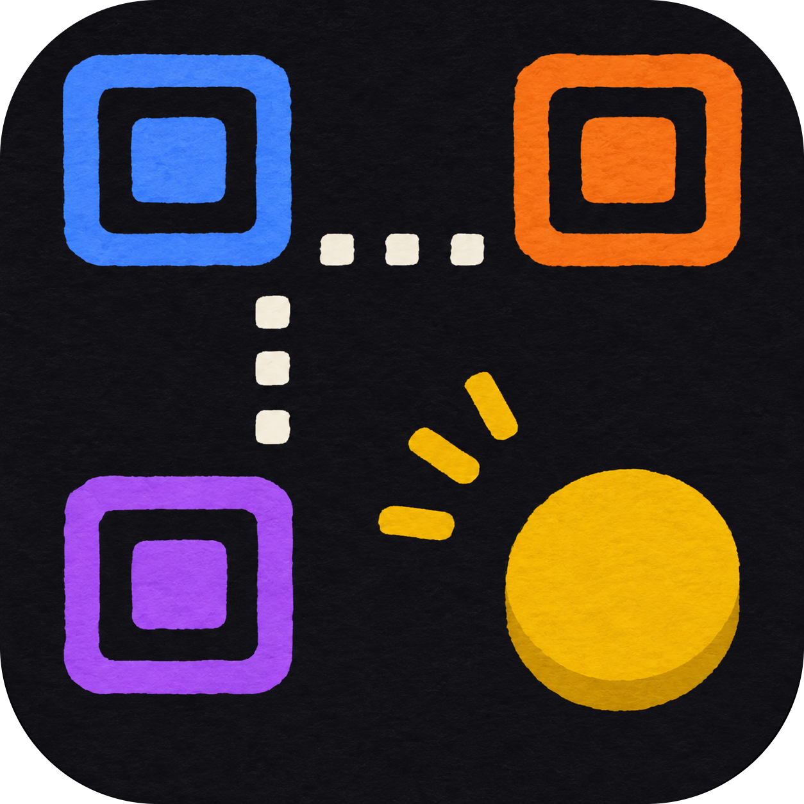
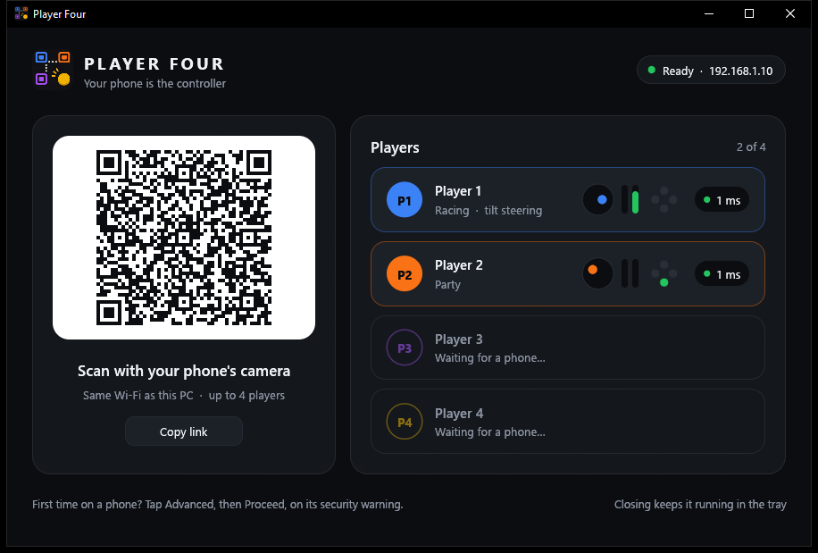
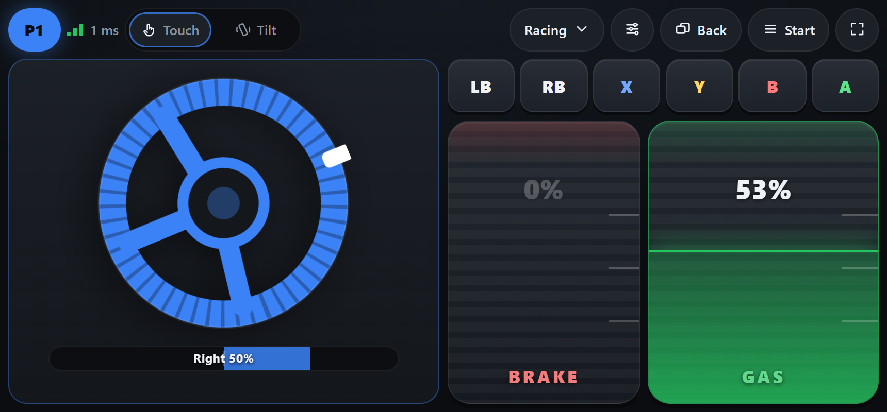

<div align="center">



# Player Four

**Your phone is the controller.**

Scan a QR code and up to four phones become Xbox controllers on your PC.<br>
No app to install, no account, nothing online.




</div>

## Why

Not everyone owns four controllers, but almost everyone has a phone. Player Four turns
the phones already in the room into controllers for couch co-op, party games and racing
games, for free.

## Features

- **Four players, one QR code.** Every phone scans the same code and becomes its own
  Xbox 360 controller. Games see real controllers, so there's nothing to set up in the game.
- **Racing that feels right.** Steer by tilting the phone or with a touch wheel, and press
  gas and brake as gently or as hard as you like.
- **A layout for every game.** Racing, Party (one stick, four big buttons), Retro (D-pad)
  and a Full pad with every button.
- **Built for low latency.** Phone and PC talk directly over your Wi-Fi. There's no server
  in between, and a late input is dropped rather than waited for.
- **Light on your PC.** A small native app. Hidden in the tray, it uses no CPU, even mid-game.

<p align="center">
  
  
</p>

## Play

1. Install [ViGEmBus](https://github.com/nefarius/ViGEmBus/releases/latest) once. It's the
   driver that creates the virtual controllers, and Player Four tells you if it's missing.
2. Open **Player Four** on the PC.
3. Scan the QR code with each phone's camera. Phones need to be on the same Wi-Fi as the PC.
4. The first time, each phone's browser warns about the connection. Tap **Advanced →
   Proceed** on Android, or **Show Details → visit this website** on iPhone. The warning
   is about the PC's own certificate, which phones need before they'll share their tilt sensor.
5. Pick a layout and play.

Closing the window keeps Player Four in the tray, so everyone stays connected.

## How it works

```
phone browser ── WebRTC, over your Wi-Fi ──▶ player-four.exe ── ViGEmBus ──▶ Xbox 360 controller ──▶ game
```

- The QR code holds everything a phone needs to reach the PC: its address, a one-time
  password and its certificate's fingerprint. The phone builds the connection itself, so
  there's no signaling server.
- Each input is a 14-byte packet in XInput's own layout, sent on an unordered channel with
  no retransmits.
- The PC app is Rust ([str0m](https://github.com/algesten/str0m) for WebRTC,
  [egui](https://github.com/emilk/egui) for the window). The phone app is plain JavaScript,
  checked by strict TypeScript, with no build step.

## Build from source

You'll need Windows 10/11, [Rust](https://rustup.rs) and ViGEmBus.

```
cd spike
cargo build --release
```

Then run `spike\target\release\player-four.exe`. It serves the phone app from `phone/`,
so keep the folders together.

**Tests:** `node tests/run.mjs` type-checks the phone app, then plays phones in headless
Chrome against the real PC app and reads the controllers back the way a game would.
It needs Node 22+, Chrome and ViGEmBus.

| Folder   | What's inside                                              |
| -------- | ---------------------------------------------------------- |
| `phone/` | The controller web app that phones open                    |
| `spike/` | The PC app: connections, virtual controllers, window, tray |
| `tests/` | End-to-end tests                                           |
| `brand/` | Logo files                                                 |

## Roadmap

- [x] Four phones, four controllers, one QR code
- [x] Racing with tilt or touch steering and analog pedals
- [x] Party, Retro and Full pad layouts
- [x] PC window with tray icon
- [ ] One-file download, no source folder needed
- [ ] No certificate warning on phones
- [ ] Player names
- [ ] Phone vibrates when the game rumbles
- [ ] Linux and Steam Deck

## License

Player Four will be free and open source. The license is still being chosen.
